# PointsMan

**A guardrail gate for building software with AI coding agents.**
Two gates: the **set-up gate** scaffolds the rules into a repo and checks the repo
follows them (like ESLint, for your *agent setup*); the **change gate** reviews
each diff for the mistakes agents actually make and keeps your QA sheet honest.
The core is **zero-dependency and model-free**; the deeper semantic review is an
optional add-on you turn on with your own model key.

<p align="center">
  
</p>

```bash
# set-up gate — does the repo have the guardrails?
npx pointsman init       # add the guardrail files to your project
npx pointsman check      # pass/fail — run it in CI to block unsafe setups

# change gate — what does this change actually do?
npx pointsman review     # impact-aware review of the current diff
npx pointsman tests      # seed / drift-check a living QA test sheet
```

---

## Why this exists

I spent a year building and shipping a real, production mobile app almost entirely
by directing AI coding agents. The code wasn't the hard part — keeping it **safe
and sane** was. Agents are fast and literal: left ungoverned they'll deploy
without asking, rename a shipped API field, guess at a backend shape, or quietly
swallow an error that then lives for weeks.

What made it work was a small set of **guardrails** that grew out of real
incidents:

- a feature got built against the wrong internal format because the task was
  ambiguous → **restate the task before coding, ask one question when unsure**;
- a preview-only control leaked into the real app via a deep link → **hard rules
  the agent must always honour**;
- a near-miss deploy → **an explicit human-approval gate on anything risky**;
- client code wired against a backend shape that then changed → **write the API
  contract first, agree it, then wire**;
- choices that no one could later explain → **log every notable decision**.

`pointsman` packages those guardrails so anyone building with agents gets them on
day one instead of learning them the hard way.

## What `init` installs

| File | What it does |
|------|--------------|
| `CLAUDE.md` | The agent's operating manual: how to start, the approval gate, hard rules, decisions, contracts, design flags. |
| `rules.md` | The invariants `pointsman review` checks each change against — yours to edit. |
| `docs/contracts/BACKEND_CONTRACT.template.md` | A contract to fill in before wiring any API. |
| `DECISIONS.md` | A one-line-per-choice log. |
| `.gitignore` | Keeps secrets and `node_modules` out of git. |

(`init` never overwrites a file you already have.)

## What `check` gates

Required (fail → exit 1, blocks CI):
- an **agent manual** is present;
- it **requires human approval** before deploy / publish / delete;
- **secrets are kept out of git**.

Recommended (warn):
- a **decision / change log** exists;
- an **API-contract** convention is in place.

## What `review` gates

`pointsman review` reads `git diff` and classifies the change by impact
(`security · scoring/money · data · behaviour · cosmetic`), with a `file:line`
anchor and a `verified` label on every finding.

**Deterministic layer — zero-dep, always on** (these are the headline failures of
fast, agent-written code):
- 🔴 **re-introduced / hardcoded secret** — a literal key added to source;
- 🔴 **silent-zero on failure** — a catch that returns `0` / "wrong" instead of "unavailable";
- 🟡 **value-path changed** — an edit to a scoring / money / credit path (confirm it's intended);
- 🟡 **silent catch** — an empty `catch {}`.

`--gate` (auto-on in CI) exits 1 on any 🔴. See [`examples/review.example.md`](examples/review.example.md).

**Semantic layer — optional, your model key.** The rules a regex can't judge
(behaviour hidden in a "UI" commit, API drift after a dependency bump, a fix
reversed by a later commit) are left to an optional model pass — one key, from an
env var, never committed. The core never depends on it. See
[`docs/review-and-tests.md`](docs/review-and-tests.md).

`pointsman tests` seeds a human-readable QA sheet (`pointsman-tests.csv`) and, on
each diff, points at the areas whose cases likely need review — keeping the sheet
honest as the code changes.

## Use it in CI

```yaml
# .github/workflows/pointsman.yml
name: pointsman
on: [pull_request]
jobs:
  gate:
    runs-on: ubuntu-latest
    steps:
      - uses: actions/checkout@v4
        with:
          fetch-depth: 0            # review needs the base branch to diff against
      - run: npx pointsman check    # set-up gate
      - run: npx pointsman review "origin/${{ github.base_ref }}...HEAD" --gate
```

## Status

Early (v0.1). The **set-up gate** (`init` / `check`) and the **deterministic
change gate** (`review` / `tests`) are done and dependency-free. The **semantic
review layer** (the model-powered rules + `verified`/`claimed`) and `.xlsx`
export of the test sheet are on the roadmap — see
[`docs/review-and-tests.md`](docs/review-and-tests.md). Ideas, issues, and PRs welcome.

## License

MIT.
